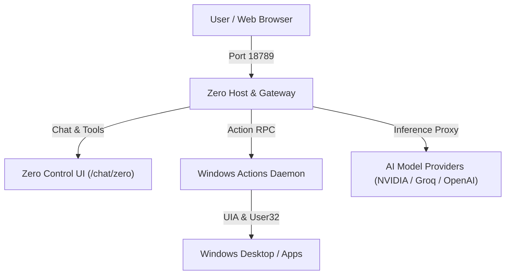

# Zero AI — Autonomous Personal Assistant & Desktop Automation

Zero AI is a sovereign, high-performance personal AI assistant built for deep Windows desktop automation, unified model routing, and rich interactive chat control.

---

## Key Capabilities

- **Single-Port Architecture (`18789`):** Unified HTTP/WebSocket gateway managing chat completions, model discovery, and frontend assets on a single, secure port.
- **Physical Windows Automation:** Native Windows OS driver supporting mouse movement, physical hardware clicks, key sequences, UIA element mapping, foreground window management, and multimedia playback without sandbox restrictions.
- **Unified Model Gateway:** Provider manager supporting OpenAI-compatible endpoints, NVIDIA NIM, Groq, Ollama, and custom cloud providers with write-only credential vaults.
- **Dynamic Control UI:** Lit-based modern dark interface with theme-synced custom dropdowns, permanent top-level controls (`Computer Control: Active`, `Reasoning: ON`), and instant session management.
- **Autonomous Multi-Step Loop:** `Observe -> Act -> Verify` execution pattern with live preview cards and human-takeover safety bailouts.

---

## Architecture Overview



---

## Quick Start

### 1. Prerequisites
- Windows 10/11 x64
- Node.js 20+
- PowerShell 7+

### 2. Launching Zero Host
Run the unified host daemon:
```powershell
powershell -ExecutionPolicy Bypass -File .\zero-host.ps1
```

Once running, navigate to:
```
http://127.0.0.1:18789/chat/zero
```

### 3. Running Test Suite
Execute the full unit test suite (128 passing tests):
```bash
node --test app/zero-control-ui/test/*.test.mjs
```

### 4. Building UI Assets
To compile and bundle frontend assets:
```bash
node build.mjs
```

---

## License

Proprietary & Confidential · Zero AI Project
