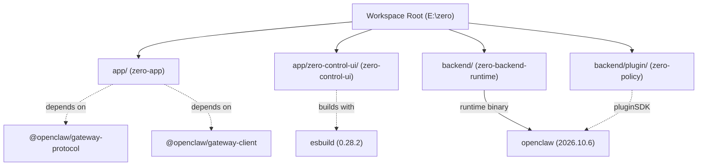

# Zero AI — Dependency & Runtime Map

**Audit Date:** 2026-11-01  
**Repository:** https://github.com/aipubg/zero  
**Scope:** Package manifests, lockfiles, runtime dependencies, native OS bindings, and process chains

---

## 1. Package Manifests & Workspaces

The repository is structured as a multi-package pnpm workspace with four explicit `package.json` manifests:



### Manifest Specifications

| Package Name | Path | Version | Private | Type | Key Dependencies | Key DevDependencies |
|---|---|---|---|---|---|---|
| `zero-app` | `app/package.json` | `0.2.0` | `true` | `module` | `@openclaw/gateway-client@2026.10.6`<br/>`@openclaw/gateway-protocol@2026.10.6`<br/>`zod@3.25.76` | `@types/node@^26.6.3`<br/>`typescript@^6.0.3` |
| `zero-control-ui` | `app/zero-control-ui/package.json` | `0.1.0` | `true` | `module` | *None (peer: `openclaw@>=2026.10.6`)* | `esbuild@0.28.2` |
| `zero-backend-runtime` | `backend/package.json` | `0.1.0` | `true` | `module` | `openclaw@2026.10.6` | *None* |
| `zero-policy` | `backend/plugin/package.json` | `0.1.3` | `true` | `module` | *None (peer: `openclaw@>=2026.10.6`)* | *None* |

---

## 2. Upstream Runtime Dependency Analysis

### 2.1 The `openclaw` Upstream Dependency Chain
The platform currently relies on `openclaw@2026.10.6` for its core process execution:
1. **Host Execution:** `zero-host.ps1` runs:
   ```powershell
   & 'E:\zero\backend\node_modules\.bin\openclaw.cmd' gateway --port 18789
   ```
2. **Plugin SDK Seams:** `backend/plugin/index.js` and `app/zero-control-ui/index.js` import:
   ```javascript
   import { buildJsonPluginConfigSchema, definePluginEntry } from "openclaw/plugin-sdk/plugin-entry";
   ```
3. **Internal Dist Patching:** Because the upstream binary contains hardcoded branding and model filters, `backend/scripts/apply-zero-branding.mjs` directly mutates files in:
   - `backend/node_modules/openclaw/dist/server-start-*.mjs`
   - `backend/node_modules/openclaw/dist/models-*.mjs`
   - `zero-system/state/node-runtime/current/node_modules/openclaw/dist/*`

### 2.2 Critical Vulnerabilities of Upstream Coupling
- **Brittleness:** Any reinstall (`pnpm install`) or package cache eviction completely wipes the runtime patches, causing legacy branding, logos, and broken model listings to instantly reappear.
- **Node.js Engine Lock:** Upstream requires `node: >=24.22.1 <25 || >=26.12.1`.
- **Telemetry & Updates:** Requires explicit environment variable suppression:
  ```powershell
  $env:OPENCLAW_NO_AUTO_UPDATE = '1'
  $env:DO_NOT_TRACK = '1'
  ```

---

## 3. Platform & System Dependencies

### 3.1 Operating System & Hardware Execution
The desktop automation engine relies directly on Windows OS subsystems:
- **User32.dll (Win32 API):**
  - `SetForegroundWindow`, `ShowWindow`, `GetForegroundWindow`: Foreground focus management.
  - `mouse_event`, `SendInput`: Physical mouse movement and hardware click simulation (used to bypass browser autoplay blocks).
  - `keybd_event`, `SendInput`: Physical keyboard keystroke dispatch.
- **UI Automation (UIA) COM Framework:**
  - `UIAutomationClient.dll` and `UIAutomationTypes.dll` referenced in PowerShell scripts (`uia-snapshot.ps1` and `win-actions.ps1`).
  - Used for accessibility tree inspection, element name resolution, and coordinate discovery.
- **PowerShell Execution Environment:**
  - PowerShell 5.1 / PowerShell 7 invoked with `-ExecutionPolicy Bypass`.
  - Persistent background daemon `win-actions-daemon.ps1` reading JSON commands via standard input/output.

### 3.2 Database & Persistence Layer
- **SQLite Engine (`node:sqlite`):**
  - Node.js 24 native `DatabaseSync` interface.
  - Used for storing session events, heads, audit records, leases, and device configurations in `zero-system/state/state/openclaw.sqlite`.
- **Local JSON Data Stores:**
  - `models/gateway-providers.json`: Dynamic provider definitions and API credentials.
  - `models/gateway-defaults.json`: Primary model bindings and default agent associations.
  - `rules/active-mode.json`: Current operational mode (Owner vs Distribution).

---

## 4. Transitive Dependency Map & Build Pipeline

```text
[Frontend Build: app/zero-control-ui/build.mjs]
    ├── Input: app/zero-control-ui/browser.js
    │     └── app/zero-control-ui/src/native-surfaces.js
    │           ├── src/agents/subagent-delegator.mjs
    │           ├── src/computer/operator.js
    │           ├── src/spaces/generative-widgets.js
    │           └── src/shared/dom.js, format.js, routes.js
    ├── Input: app/zero-control-ui/index.css
    ├── Bundler: esbuild 0.28.2 (Platform: neutral, Format: esm)
    └── Output: app/zero-control-ui/dist/control-ui/<content-hash>/
          ├── index.js (~113 KB)
          └── index.css (~40 KB)
```

---

## 5. Security & Credential Handling Risks

1. **Plaintext Secret Storage:**
   `models/gateway-providers.json` stores active API keys in unencrypted plaintext on disk and within the git working tree:
   ```json
   "apiKey": "nvapi-REDACTED"
   ```
2. **Unvalidated Open Proxy:**
   `backend/gateway/server.mjs` endpoint `/api/gateway/proxy` forwards HTTP requests to arbitrary `targetUrl` or `baseUrl` specified in the client request body, without URL domain allowlisting or server-side destination verification.
3. **Hardcoded Machine Root Paths:**
   Multiple scripts, configs (`zero.json`), and build utilities have absolute paths pointing to `E:\zero`.
