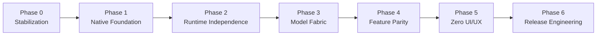

# Zero AI — Master Engineering Execution Roadmap

**Audit Date:** 2026-11-01  
**Repository:** https://github.com/aipubg/zero  
**Framework:** Phased Migration Strategy (Directive §11)  
**Guiding Principle:** Preserve working functionality. Incremental, test-verified changes. No blind rewrites.

---

## Roadmap Overview

---

## Phase 0 — Stabilization (Immediate Priority)

### Objectives
- Eliminate destructive startup side effects.
- Fix broken test suites to establish an accurate, green baseline.
- Remove code duplication and obsolete test fixtures.
- Protect user conversation history and credentials.

### Detailed Engineering Tasks
1. **Remove Destructive Session Purges:**
   - Remove `node E:\zero\backend\scripts\purge-all-test-sessions.mjs` from `start-all.ps1`.
   - Ensure production database tables (`session_state_events`, `session_state_heads`) are never dropped on startup.
2. **Fix Broken Unit Tests:**
   - Fix `backend/scripts/test/migrate-zero-only-agents.test.mjs` by updating the template path from `openclaw.template.json` to `zero.template.json`.
   - Fix `app/test/bridge.test.mjs` by aligning bridge test expectations with the native `zero-control-ui` architecture or isolating obsolete bridge specs.
   - Fix `backend/gateway/registry.ts` to guard `localStorage` with `typeof window !== 'undefined'` so server-side imports do not throw `ReferenceError`.
3. **Eliminate Code Duplication:**
   - Remove redundant `src/gateway/` directory (identical copy of `backend/gateway/`).
4. **Secure API Credentials:**
   - Remove hardcoded API keys from `models/gateway-providers.json` and replace with environment variable references or local encrypted DPAPI store.

### Acceptance Criteria
- Running `node --test` on all test suites yields 0 errors.
- Application boots without deleting existing chat sessions.
- No duplicate directories in tree.

---

## Phase 1 — Native Zero Foundation

### Objectives
- Establish a single, authoritative Zero Host control plane on port `18789`.
- Eliminate hardcoded absolute machine paths (`E:\zero`).
- Create typed configuration and runtime contracts.

### Detailed Engineering Tasks
1. **Universal Path Normalization:**
   - Implement `packages/shared/paths.mjs` (or `backend/config/paths.mjs`) resolving paths relative to `process.env.ZERO_ROOT` or repository root.
   - Refactor `backend/config/zero.json`, `zero-system/config/zero.json`, `server.mjs`, and PowerShell scripts to use dynamic paths.
2. **Unified Single-Port Architecture (`18789`):**
   - Consolidate all endpoints (`/health`, `/v1/chat/completions`, `/v1/models`, `/api/gateway/*`, `/api/zero/*`, and WebSocket RPC) into the single Zero Host.
   - Retire standalone `zero-gateway.ps1` (port 18790) and unify `start-all.ps1` into a single process command.
3. **Typed Configuration Schema:**
   - Introduce strict Zod validation schemas for all Zero configurations (`config/zero.json`).

### Acceptance Criteria
- Application starts and operates identically regardless of whether installed at `E:\zero`, `C:\zero`, or any other directory.
- Exactly one public port (`18789`) is bound and serving all APIs, WebSockets, and static assets.

---

## Phase 2 — Runtime Independence

### Objectives
- Replace reliance on `openclaw.cmd gateway` with a native Zero Host runner.
- Replace startup-time source patching (`apply-zero-branding.mjs`) with build-time compilation and clean extension seams.

### Detailed Engineering Tasks
1. **Zero-Native Host Service:**
   - Create `backend/server/index.mjs` (Zero Host) implementing the HTTP/WebSocket gateway server directly using native Node.js HTTP/WS or Fastify/Hono.
   - Wire WebSocket JSON-RPC handlers directly to the session manager and agent orchestrator.
2. **Decommission Runtime Source Patching:**
   - Implement native model catalog filtering and request routing inside Zero Host source code.
   - Ensure UI bundle from `app/zero-control-ui/dist/` is served directly without modifying files inside `node_modules`.
   - Remove `apply-zero-branding.mjs`.
3. **Database Schema Governance:**
   - Establish clean SQLite schema initialization and migration scripts (`backend/database/migrations/`).
   - Standardize table naming (`zero_sessions`, `zero_audit_log`, `zero_state_leases`).

### Acceptance Criteria
- `zero-host.ps1` boots Zero Host without calling `openclaw.cmd`.
- No files inside `node_modules` are read or modified at startup.
- Full startup cycle completes in under 1.5 seconds.

---

## Phase 3 — Zero Model Fabric

### Objectives
- Transform the gateway into a high-reliability Zero Model Fabric.
- Eliminate loose model matching, arbitrary fallbacks, and canned regex intercepts.
- Support local GGUF models and cloud providers with deterministic routing and validated streaming.

### Detailed Engineering Tasks
1. **Deterministic Inference Router:**
   - Replace fuzzy substring matching with exact canonical model IDs (`<provider-id>/<model-name>`).
   - Remove silent fallbacks to "first active provider". Return explicit 404/400 errors with actionable resolution hints.
2. **Remove Canned Regex Intercepts:**
   - Remove `isYouTubeCmd`, `isNotepadCmd`, and `replyMatch` bypasses from `server.mjs`.
   - Route all chat completions through the model inference pipeline with declared function tools.
3. **Model Tool Execution Loop:**
   - Parse model `tool_calls` and dispatch them through `ComputerOperator` or plugin tools.
   - Feed tool execution results back to the model for final synthesis.
4. **Secure Provider Proxy:**
   - Implement server-side URL validation and allowlisting for `/api/gateway/proxy` to eliminate SSRF risks.
5. **Failover & Streaming Resilience:**
   - Implement retry policies with exponential backoff on 429/503 errors.
   - Handle client disconnection and abort signals cleanly without orphaned upstream connections.

### Acceptance Criteria
- Real chat prompts ("Open notepad and type test") execute via model tool-calling rather than regex intercepts.
- Proxy refuses unlisted external destinations.
- Local GGUF models and NVIDIA NIM models execute reliably with token streaming.

---

## 4. Phase 4 — Feature Parity

### Objectives
- Achieve verified capability parity with the reference platform across all functional domains.
- Strengthen Windows desktop automation (`OBSERVE -> ACT -> VERIFY`).

### Detailed Engineering Tasks
1. **Agent Orchestration & Subagent Handoff:**
   - Implement durable task lifecycle tracking (`PENDING`, `RUNNING`, `COMPLETED`, `FAILED`, `CANCELLED`).
   - Implement agent-to-agent delegation with scoped workspaces and streaming event feedback.
2. **Advanced Computer Automation:**
   - Verify multi-step visual workflows with automated before/after screenshot comparisons.
   - Support foreground window targeting, coordinate scaling, and accessibility fallback.
3. **Skills & Plugins Ecosystem:**
   - Integrate `DynamicPluginLoader` with the unified agent execution loop so skills are automatically available as agent tools.
4. **Task Scheduling & Cron Engine:**
   - Establish a native background cron scheduler in Zero Host that persists jobs across restarts.

### Acceptance Criteria
- End-to-end multi-step tasks run autonomously with human safety takeover enabled.
- Drop-in plugins in `plugins/` automatically register tools in the chat interface.

---

## 5. Phase 5 — Zero UI/UX

### Objectives
- Complete the original Zero product experience.
- Maintain permanent top-level controls, theme-synced custom components, and real-time execution feedback.

### Detailed Engineering Tasks
1. **Original Application Shell:**
   - Refine the sidebar navigation, space switchers, and session management.
   - Ensure permanent top actions (`Computer Control: Active`, `Reasoning: ON`) are seamlessly integrated into the navigation chrome.
2. **Generative UI & Visual Cards:**
   - Enhance generative widgets (`zero-ui:media`, `zero-ui:progress`, `zero-ui:diff`) with interactive playback and inspection controls.
3. **Complete Identity Polish:**
   - Verify that 100% of user-visible elements, favicons, page titles, empty states, and notifications use the sovereign Zero AI identity.

### Acceptance Criteria
- 0 references to upstream branding or mascots anywhere in the UI or Shadow DOM.
- Fluid responsive layout with real-time streaming tokens and progress updates.

---

## 6. Phase 6 — Release Engineering

### Objectives
- Ensure zero-dependency installation, cross-machine portability, and automated packaging.
- Deliver green CI/CD pipelines and comprehensive end-to-end verification.

### Detailed Engineering Tasks
1. **Packaging & One-Click Installer:**
   - Create portable distribution scripts and executable installers for Windows.
   - Verify clean install on a fresh Windows sandbox without pre-existing environment variables.
2. **Full Regression Test Suite:**
   - Automated end-to-end Playwright tests verifying fresh install, model setup, chat, tool call, desktop action, restart, and history recovery.
3. **Documentation & Operational Handover:**
   - Complete architectural guides, API documentation, and troubleshooting runbooks in `docs/`.

### Acceptance Criteria
- 100% automated test pass rate.
- Installation and execution on fresh machine verified with zero manual path edits.
